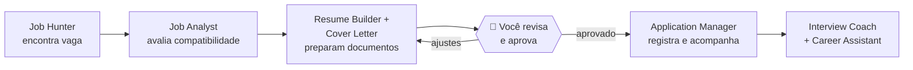
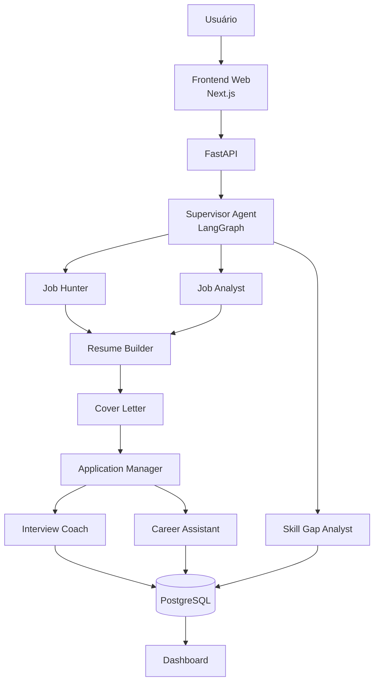

# 🤖 CareerFlow AI

> Assistente pessoal de carreira baseado em agentes de IA: encontra vagas, avalia compatibilidade, prepara candidaturas e acompanha processos seletivos, sempre com aprovação humana.


**Menos tempo procurando oportunidades. Mais tempo se preparando para conquistá-las.**

---

## 📑 Sumário

- [Visão geral](#-visão-geral)
- [Como funciona](#-como-funciona)
- [Agentes](#-agentes)
- [Compatibilidade de vagas](#-compatibilidade-de-vagas)
- [Arquitetura](#-arquitetura)
- [Stack](#-stack)
- [Estrutura de pastas](#-estrutura-de-pastas)
- [Como rodar](#-como-rodar)
- [Roadmap](#-roadmap)
- [Segurança e princípios](#-segurança-e-princípios)
- [Visão de futuro](#-visão-de-futuro)

---

## 🎯 Visão geral

Procurar emprego ou estágio é trabalho repetitivo: garimpar vagas, ler requisitos, adaptar currículo, escrever cartas, controlar prazos. O **CareerFlow AI** automatiza essas etapas com uma **arquitetura multiagentes**, em que cada agente cuida de uma responsabilidade e um **Supervisor** coordena tudo.

**O que o sistema faz:**

- Busca vagas de estágio, trainee e emprego e evita duplicatas
- Compara os requisitos com o seu perfil e gera uma nota de 0 a 100, com explicação
- Gera currículos e cartas de apresentação personalizados por vaga
- Acompanha candidaturas e processos seletivos
- Prepara você para entrevistas e aponta lacunas de conhecimento
- Centraliza tudo em um dashboard

**O que o sistema não faz:** não substitui o candidato e **nunca envia uma candidatura sem a sua aprovação**.

---

## 🔄 Como funciona



1. O agente encontra uma oportunidade.
2. O analista avalia a compatibilidade com o seu perfil.
3. Os agentes de currículo e carta preparam os documentos.
4. Você recebe uma notificação e revisa o material.
5. Você aprova ou pede alterações.
6. A candidatura só é enviada **após a sua autorização**.

---

## 🧠 Agentes

| Agente | Responsabilidade |
|---|---|
| **Supervisor** | Recebe pedidos, distribui tarefas, trata erros e novas tentativas, consolida resultados |
| **Job Hunter** | Pesquisa vagas, filtra por localização e modalidade, extrai requisitos, remove duplicatas, repete a busca periodicamente |
| **Job Analyst** | Interpreta a vaga, compara com o perfil, calcula a compatibilidade e prioriza oportunidades |
| **Resume Builder** | Adapta o currículo principal à vaga e gera PDF, mantendo histórico das versões |
| **Cover Letter** | Analisa empresa e vaga e escreve cartas personalizadas |
| **Application Manager** | Registra candidaturas, atualiza status, guarda datas e sinaliza processos parados |
| **Interview Coach** | Simula entrevistas técnicas e comportamentais, avalia respostas e sugere melhorias |
| **Skill Gap Analyst** | Mapeia tecnologias recorrentes, identifica lacunas e monta planos de estudo |
| **Career Assistant** | Envia alertas (vagas, entrevistas, testes, prazos), resumos periódicos e detecta mensagens de recrutadores |

> ⚠️ **Regra fundamental:** o Resume Builder **nunca inventa** experiências, conhecimentos, certificações ou qualificações. Ele só reorganiza e destaca o que existe no seu perfil.

### Status de uma candidatura

`Encontrada` → `Em análise` → `Aguardando aprovação` → `Candidatura enviada` → `Em processo seletivo` → `Entrevista agendada` / `Teste técnico` → `Aprovado` / `Reprovado` / `Encerrado`

---

## 📊 Compatibilidade de vagas

Cada vaga recebe uma nota de **0 a 100**, calculada por critérios ponderados (pesos configuráveis no futuro):

| Critério | Peso inicial |
|---|---:|
| Conhecimentos técnicos | 35% |
| Experiência e projetos | 25% |
| Formação acadêmica | 20% |
| Idiomas | 10% |
| Requisitos adicionais | 10% |

O sistema **explica a nota**. Exemplo para *Desenvolvedor Full Stack Júnior*:

| Critério | Resultado |
|---|---|
| **Compatibilidade geral** | **87/100** |
| Python | ✅ Compatível |
| JavaScript | ✅ Compatível |
| React | ✅ Compatível |
| Node.js | 🟡 Parcial |
| Experiência profissional | ⚠️ Requer atenção |
| Inglês | ✅ Compatível |

---

## 🏗️ Arquitetura



O projeto é dividido em módulos independentes para facilitar manutenção, testes e expansão.

---

## 🛠️ Stack

| Camada | Tecnologias |
|---|---|
| **Backend** | Python, FastAPI, Pydantic, SQLAlchemy |
| **IA** | OpenAI API, LangGraph, LangChain |
| **Frontend** | React, TypeScript, Next.js, Tailwind CSS |
| **Dados** | PostgreSQL (Redis futuramente) |
| **Integrações** | n8n, Gmail, APIs de plataformas de emprego, notificações por e-mail |
| **Infra e qualidade** | Docker, Git/GitHub, Pytest |

---

## 📁 Estrutura de pastas

```text
careerflow-ai/
├── backend/
│   ├── app/
│   │   ├── agents/          # um arquivo por agente
│   │   ├── api/             # rotas FastAPI
│   │   ├── core/            # config, segurança
│   │   ├── database/        # conexão e migrações
│   │   ├── models/          # modelos SQLAlchemy
│   │   ├── schemas/         # schemas Pydantic
│   │   ├── services/        # regras de negócio
│   │   ├── integrations/    # Gmail, plataformas de vagas
│   │   └── main.py
│   ├── tests/
│   └── requirements.txt
├── frontend/
│   └── src/ (app, components, services, hooks)
├── infrastructure/
│   ├── docker/
│   └── n8n/
├── docs/                    # architecture.md, agents.md, database.md
├── .env.example
├── docker-compose.yml
└── README.md
```

---

## 🚀 Como rodar

> 🚧 O projeto está em fase inicial. Esta seção será preenchida conforme o ambiente for configurado.

```bash
# 1. Clonar o repositório
git clone https://github.com/JonnyMarcus/careerflow-ai.git
cd careerflow-ai

# 2. Configurar variáveis de ambiente
cp .env.example .env   # preencha OPENAI_API_KEY e dados do banco

# 3. Subir os serviços (quando o Docker estiver configurado)
docker compose up --build
```

---

## 🗺️ Roadmap

O desenvolvimento é incremental, para evitar complexidade desnecessária no início.

- [ ] **Fase 1 — Estrutura inicial:** ambiente Python, estrutura do projeto, Git/GitHub, banco de dados, cadastro de perfil profissional
- [ ] **Fase 2 — Busca de vagas:** Job Hunter, fontes de vagas, filtros, detecção de duplicatas, armazenamento
- [ ] **Fase 3 — Análise:** integração com IA, Job Analyst, pontuação, requisitos ausentes, Skill Gap Analyst
- [ ] **Fase 4 — Documentos:** Resume Builder, modelos e PDF, Cover Letter Agent, fluxo de revisão e aprovação
- [ ] **Fase 5 — Gerenciamento:** Application Manager, histórico, acompanhamento, notificações, Career Assistant
- [ ] **Fase 6 — Preparação:** Interview Coach, simulador, avaliação de respostas, recomendações de estudo
- [ ] **Fase 7 — Interface:** dashboard, páginas de vagas, candidaturas, documentos e configurações
- [ ] **Fase 8 — Integração e infra:** orquestração com LangGraph, Docker, testes, logs e tratamento de erros, deploy

---

## 🔐 Segurança e princípios

- Chaves de API somente em variáveis de ambiente
- Autenticação e proteção de dados pessoais e profissionais
- Registro (log) das ações importantes dos agentes
- Validação das informações antes de gerar documentos
- Prevenção de candidaturas duplicadas
- **Nenhum envio sem autorização explícita do usuário**
- Respeito aos termos de uso das plataformas; integrações oficiais sempre que possível

---

## 🔭 Visão de futuro

- Identificar tendências do mercado e recomendar trilhas de aprendizagem
- Sugerir empresas alinhadas aos objetivos do usuário
- Monitorar oportunidades continuamente
- Gerar relatórios de desempenho das candidaturas

---

## 📌 Filosofia

O CareerFlow AI não pretende substituir o candidato. Seu propósito é usar IA para reduzir tarefas repetitivas, organizar informações e ajudar você a tomar decisões profissionais melhores.
